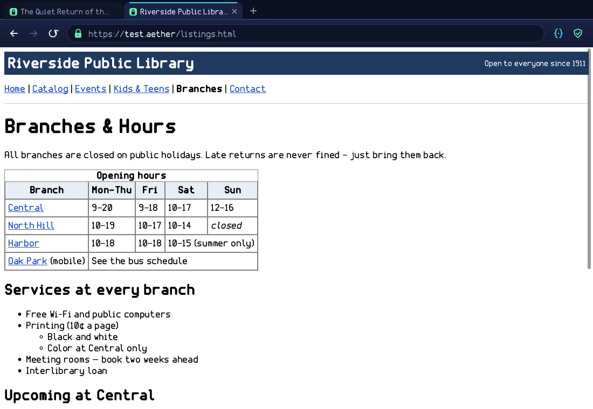

# The browser

æther comes with Browser, a small web browser built for safety first. It
renders HTML, CSS and pictures, with text drawn in Facet, æther's own font.
Pages can run scripts in **æther script**, a JavaScript engine written
from scratch for this browser with tighter limits than a usual browser:
scripts run only on https pages, only the site's own by default, can talk
only to their own origin, and keep nothing after the window closes. A
toolbar button changes that per site (see [Scripts](#scripts)).

It has no plugins, no extensions and no downloads. It keeps no cookies,
no local storage and no cache on disk: closing the window forgets everything.
Pages can't load fonts (everything is drawn in Facet). Pictures are decoded
by the browser's own PNG, JPEG, GIF and BMP decoders, with hard limits; a
picture that can't be decoded keeps its alt text. Addresses are https unless
you choose otherwise, and plain http needs your consent each time for a site.

Tabs work like a modern browser: **Ctrl+T** opens one, **Ctrl+W** closes it,
**Ctrl+Tab** / **Ctrl+Shift+Tab** move between them, and **Ctrl+1** to
**Ctrl+9** jump to a tab. Every tab keeps its own history, scroll position,
scripts and http choices.

The whole browser is Rust written for æther with no external crates: the
HTML parser, the CSS engine, layout, painting, the picture decoders and the
window. It uses only
`std`, `aether-host` (windows and input) and `webnet` (the network layer).

```sh
tools/build.sh                    # builds build/browser.app (needs an Aether checkout, see below)
```

In an Aether checkout, `make browser && make` puts the released package in
the ISO (or `tools/build-browser.sh` builds it from this repository), then
`run browser` in the terminal, or click its dock icon. The browser is not
part of the installed system image.




## Engine and interface

The code is in `src`:

| Module | What it does |
|---|---|
| `html/` | Charset detection (BOM, HTTP header, `<meta>` prescan, then UTF-8 or Windows-1252/Latin-1, UTF-16), a tokenizer with character references (named, numeric, the legacy forms without `;`), and a tree builder following the HTML standard's insertion modes: implied end tags, `p`/`li`/`dd`/`td` auto-closing, void elements, raw text for `script`/`style`/`textarea`/`title`, tables with foster parenting, the adoption agency for misnested formatting, SVG and MathML as foreign content. `<noscript>` is parsed as ordinary markup, then hidden when the page's scripts run. |
| `css/` | A CSS Syntax 3 tokenizer, a stylesheet parser (`@media` evaluated against the window, `@import`, `@supports`; `@font-face` ignored), selectors up to Selectors 4 (`:is`, `:where`, `:not`, `:has`, `:nth-*`, attribute operators; `:hover` and friends never match, so pages look the same however you point), specificity and the cascade (user agent, presentational attributes, author, inline, `!important`), inheritance, custom properties with `var()`, `calc()`/`min()`/`max()`/`clamp()`, and units px, em, rem, %, pt, vw, vh and more. A user-agent stylesheet (`css/ua.css`) gives HTML its default look. |
| `layout/` | A box tree from the styled DOM, then block flow with margin collapsing, inline flow with line breaking, `white-space`, `text-align` (with justify), baseline alignment and inline boxes; lists with bullets and numbers (decimal, roman, alpha, greek); tables with automatic column widths, `colspan`/`rowspan` and captions; flex rows and columns with wrapping; simple grids; floats as inline blocks; relative and absolute positioning; pictures at their intrinsic size, the page's width/height or `max-width`, preserving the aspect ratio; form controls. The result is a display list plus hit regions (links, fields) and anchors for `#fragments`. |
| `paint.rs` | Software drawing into the window: anti-aliased rounded rectangles, gradients, borders (solid, dashed, dotted), scaled RGBA pictures, and text. |
| `image/` | The picture decoders: PNG (non-interlaced, 8- and 16-bit, palette and tRNS), baseline and progressive JPEG (Huffman, 8x8 IDCT, 4:4:4/4:2:2/4:2:0, grayscale), GIF (first frame, LZW, transparency) and uncompressed BMP. Pure safe Rust with size limits and no `unsafe`. |
| `font.rs` | Facet outlines (generated from Aether's `tools/mkfont.py` by `tools/mkfont-rs.py`) rasterised at any size with 4x4 supersampling and cached: bold, italic and monospace variants, extra glyphs for typography (curly quotes, dashes, bullets, arrows, currency), accents composed onto letters, and a box for characters Facet doesn't have. |
| `page.rs` | Loading: fetch through the network seam, decode, parse, collect `<style>` and `<link rel=stylesheet>` (fetched through the seam, with `@import`), `<base href>`, pictures (``, `srcset` and data URLs), form submission (GET, and POST through webnet), fragments. |
| `script/` | æther script: the language (lexer, parser, interpreter, garbage collector, regular expressions, built-ins), the DOM and window bindings, and `prelude.js`, platform pieces written in æther script itself (URL, fetch, XMLHttpRequest, typed arrays, observers...). See [Scripts](#scripts). |
| `pages.rs` | The built-in pages: `about:home`, `about:security`, the http warning and error pages. |
| `ui.rs` | The window: the tab strip, toolbar, address bar, page view, input and the per-tab state. |
| `net.rs` | The seam to the network layer (see below). |

### Using it

- **Tabs.** The strip above the toolbar shows one tab per page. Click a
  tab to switch, its **×** to close it, or **+** to open a new one. The
  active tab is lighter and has a cyan top line. **Ctrl+T**, **Ctrl+W**,
  **Ctrl+Tab** and **Ctrl+1**…**Ctrl+9** do the same from the keyboard.
- **Address bar.** Click it or press **Ctrl+L**, type, press **Enter**.
  `example.com` means `https://example.com/`. The padlock is green and
  closed for https pages, red and open for http, and the æther mark for
  built-in pages.
- **Back, forward, reload, stop.** The toolbar buttons, **Alt+←**/**Alt+→**,
  **Backspace** for back, **Ctrl+R** to reload and **Esc** to stop a load in
  progress (the reload button turns into stop while loading).
- **Scrolling.** The mouse wheel, **PgUp**/**PgDn**, **Space** and
  **Shift+Space**, the arrow keys, **Home**/**End**, or drag the scrollbar.
- **Links.** Click them; the status line at the bottom shows where a link
  goes when you point at it. **Tab** and **Shift+Tab** move keyboard focus
  between links and form fields, **Enter** follows the focused link.
- **Forms.** Text fields, checkboxes, radio buttons and submit buttons
  work; forms are sent as GET (or POST, never over plain http without your
  consent). Select boxes show their selected option.
- **Plain http.** Opening an `http://` address first shows a warning page;
  "Continue over http" loads it and remembers the choice for that host until
  the window closes. Pages can't trigger "continue" themselves: the warning's
  internal links only work on the warning page, and web pages can only link
  to `about:home` and `about:security`.
- **Scripts.** The `{}` button left of the address bar shows what may run
  on this site: cyan for the site's own scripts (the default on https),
  violet for other sites' scripts too, red and crossed out for none.
  Clicking it moves through those three and reloads the page. The choice
  lasts until the window closes.
- **Pictures.** PNG, JPEG (baseline and progressive), GIF and BMP are
  decoded and drawn at their intrinsic size, or at the width and height the
  page gives. `alt` text is shown when a picture can't be loaded or decoded.
- **Errors.** When a page can't be loaded the error page shows the network
  layer's own message (`FetchError`'s text).

The window title is the active tab's title. Pages load on a worker thread,
so the window stays responsive and Stop works.

### Robustness

Every parser assumes hostile input and has limits instead of trust: tree
depth (200 open elements), node count (250 000), attribute count and size,
comment size, CSS rule count, selector length and nesting, a step budget for
selector matching, a budget for `var()` expansion, layout depth, box count,
and sizes clamped to sane ranges. Malformed input is repaired, never
rejected with a panic.

Pictures are untrusted too. A page may decode at most 96 pictures and
32 million pixels in total; each picture is at most 8192 pixels on a side,
16 million pixels in all, and 8 MiB compressed. PNG and GIF decompression is
capped before allocation, JPEG coefficients are checked for overflow, and a
damaged picture becomes its alt-text placeholder. An https page never loads
an http picture (mixed content), and no picture fetch sends cookies or a
referrer.

The test suites in `tests` include deep nesting, huge inputs,
three deterministic fuzzers (markup fragments, random bytes, stylesheets)
that run the whole pipeline down to painting, and picture tests for every
decoder, damaged input, decompression bombs and mixed content:

```sh
cargo test
cargo run --example render -- page.html out.png   # one page to PNG
```

`tests/screens.txt` drives the browser headless and dumps
screenshots of the test pages in `testpages` (an article,
a library page with navigation, lists and tables, a styled pricing page,
a picture page and a hostile page); `tools/build.sh --shots` runs
it, including a two-tab view.

## Scripts

æther script is the browser's own JavaScript engine (`src/script`),
written for æther in std-only Rust with no external crates. It runs the
JavaScript that ordinary sites use, ES2020 or so: classes, closures,
destructuring, spread, template literals, arrow functions, `async`/`await`
and promises, Map/Set/WeakMap, Symbol, JSON, regular expressions, Date and
Math. It is a tree-walking interpreter over an arena heap with a
mark-and-sweep collector, so a bug in it can't turn into machine code.

### What it leaves out, on purpose

- **No code from strings.** `eval`, `new Function`, and `setTimeout` or
  `setInterval` with a string are refused: a page can only run code it
  shipped as code.
- **No generators or modules** (`import`/`export`), no `with`, no
  WebAssembly, no workers, no shared memory, so no high-resolution timing
  tricks either.
- **No reaching out.** `fetch` and `XMLHttpRequest` reach only the page's
  own origin (scheme, host and port), with GET, HEAD or POST.
  `navigator.sendBeacon` does nothing, `window.open` is refused,
  `alert` shows in the status line, `confirm` answers no and `prompt` gives
  null. WebSockets, notifications, geolocation, camera, microphone,
  clipboard and service workers don't exist.
- **Nothing kept.** `localStorage`, `sessionStorage` and `document.cookie`
  work, but live in memory for this window only (5 MB a site), and script
  cookies are never sent to servers.

### Limits

A tab that loads in the background finishes its page, but its scripts wait
until you select the tab, so a background page can't spend the UI thread's
script budget while you read another one. Every task (a script, an event
handler, a timer) runs until it finishes or reaches a budget, then is
stopped and reported in the page's errors: 30
million steps per task (120 million for the page's first run, 40 million
for each round of timers), recursion depth 700, 2 million objects, strings
and arrays of 16 M, a million DOM nodes, 10,000 timers (at least 10 ms
apart), 2,000 fetches (6 at a time) and regular expressions with their own
step budget, so a page can't hang the browser with a runaway loop or a
catastrophic pattern. A page gets up to 200 scripts, 4 MB each and 24 MB in
all.

### Which scripts run

| Setting | Runs |
|---|---|
| This site's own (default on https) | inline scripts, and external ones from the same site (`cdn.example.com` counts as example.com) |
| Other sites' too | also external scripts from other sites, still https only |
| Off (always on plain http) | nothing; `<noscript>` content is shown |

External scripts are fetched like stylesheets, through the same seam,
firewall and TLS checks. `javascript:` links run as the page's own code
when scripts are on; typing `javascript:` in the address bar does nothing.

### How it fits the page

Scripts see the page's DOM (elements, attributes, `classList`, `style`,
`dataset`, `innerHTML`, forms, events with capture and bubbling) and the
window (`location`, `history.pushState`, timers, `requestAnimationFrame`,
`matchMedia`, `getBoundingClientRect` from the real layout). Clicks, keys,
form changes, submit, scrolling and resizing reach the page as events, and
whatever a script changes is laid out again. Navigation from a script goes
through the same checks as a click, and more than 8 script navigations in a
row are stopped.

### Not supported (by design or not yet)

Plugins, downloads, cookies, persistent storage, web fonts, WebP/AVIF/SVG
pictures, CSS background images, video, audio, iframes (shown as a
link-sized frame), canvas drawing, CSS animations and transforms, `:hover`
styling, text selection and copying, bookmarks, zoom and printing.
Characters outside Facet's set (most non-Latin scripts) are drawn as boxes.

## Network and TLS

The network layer is `webnet`, which lives in the Aether repository next to
the kernel calls it uses (`runner/webnet`; App Store uses it
too). Its URL parser, HTTP/1.1 client, TLS 1.3 and 1.2 client, certificate
checks, trust anchors and policy are described in Aether's
[docs/WEBNET.md](https://github.com/traxsdata/Aether/blob/main/docs/WEBNET.md).

### The seam

The browser reaches the network only through `src/net.rs`,
which re-exports `Url`, `Request`, `Response`, `Method`, `fetch`,
`FetchError` and `UrlError` from `webnet`. The interface maps
`FetchError::InsecureHttp` to the http warning page and shows every other
error's text on the error page. Tests and headless screenshot runs on a
host use a local fetcher instead (`BROWSER_TEST_ROOT`, see
`src/testserve.rs`), which is never used on æther.
